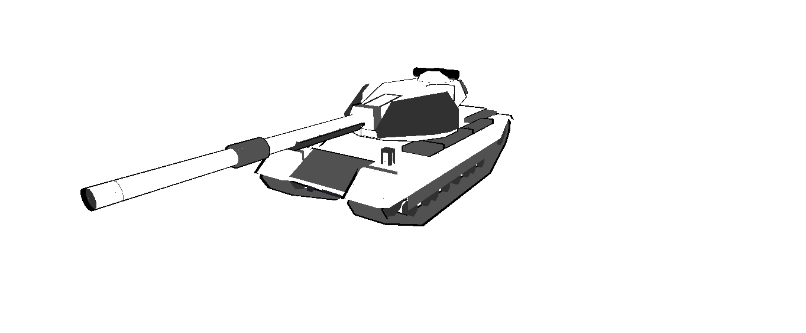

# Doodle Tank

Doodle Tank is a 2D survival and twin-stick tank game built with Godot 4. Survive 10 minutes, destroy enemies, collect bolts, and permanently upgrade your tank in the Armory.



## Overview

- Survive an escalating battle for 10 minutes.
- Fight tanks, drones, and armored cars.
- Earn bolts with a multiplier that increases every 5 minutes, up to 2.5x.
- Spend persistent bolts on health, speed, and damage upgrades.
- Supports keyboard and mouse controls on Windows.

## Quick Start

### Prerequisites

- Godot Engine **4.7.2** or later compatible with the project.
- Windows 10/11 for the configured Windows export.
- Godot export templates for Windows builds.

### Run from source

1. Clone and enter the repository:

   ```powershell
   git clone https://github.com/Dirga36/doodle_tank.git
   cd doodle_tank
   ```

2. Open the project in Godot:

   ```powershell
   & "Godot_v4.7.2-stable_win64.exe" --path . --editor
   ```

3. Press **F5** or open the opening scene at `res://scenes/opening/opening.tscn`.

The main gameplay scene is `res://scenes/game/game.tscn`; the opening scene is configured as the project entry point.

## Controls

| Action | Input |
| --- | --- |
| Move forward / backward | W/S or Up/Down |
| Turn left / right | A/D or Left/Right |
| Main cannon | Left mouse button |
| Deploy land mine | Right mouse button |
| Zoom in / out | Mouse wheel |

## Development Commands

Run these commands from the repository root in PowerShell.

| Task | Command | Description |
| --- | --- | --- |
| Open editor | `& "C:\Users\Admin\Desktop\Godot_v4.7.2-stable_win64.exe" --path . --editor` | Opens the Godot project editor |
| Run project | `& "C:\Users\Admin\Desktop\Godot_v4.7.2-stable_win64.exe" --path .` | Starts the configured opening scene |
| Run gameplay | `& "C:\Users\Admin\Desktop\Godot_v4.7.2-stable_win64.exe" --path . res://scenes/game/game.tscn` | Starts the single gameplay scene directly |
| Export Windows | `& "C:\Users\Admin\Desktop\Godot_v4.7.2-stable_win64.exe" --headless --path . --export-release "Windows Desktop" "build\DoodleTank.exe"` | Creates a Windows export |

There is currently no automated test suite. Verify changes in the Godot editor and by running the gameplay scene.

## Project Structure

```text
.
├── scenes/
│   ├── game/             # Gameplay, player, enemies, HUD, map, and effects
│   ├── menus/            # Main menu, options, tank selection, and Armory
│   ├── opening/          # Configured entry scene
│   └── windows/          # Pause and result windows
├── scripts/
│   └── game_state.gd     # Persistent save-state API
├── resources/
│   ├── player_stats.gd   # Player upgrade resource definition
│   └── player_stats.tres # Runtime and persisted player stats
├── addons/               # Third-party Maaack and editor plugins
├── docs/                 # Documentation assets
├── project.godot         # Engine, input, rendering, and scene configuration
└── export_presets.cfg    # Windows export preset
```

## CI and Deployment

The GitHub Actions workflow exports the project for Windows and can upload it to itch.io.

Repository variables:

- `GODOT_VERSION`
- `EXPORT_NAME`
- `ITCH_USERNAME`
- `ITCH_GAME`

Repository secret:

- `BUTLER_API_KEY`

The workflow runs on published releases or manual dispatch.

## Contributing

Use the existing GDScript and scene conventions, keep third-party files in `addons/` unchanged, and test gameplay in Godot before opening a pull request.

## License

This project is licensed under the [GNU General Public License v3.0](LICENSE).